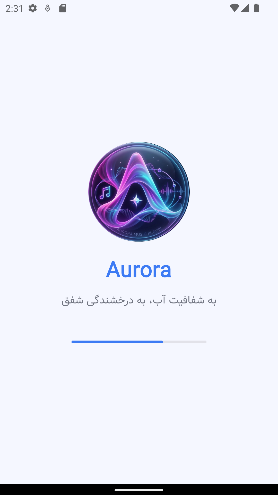
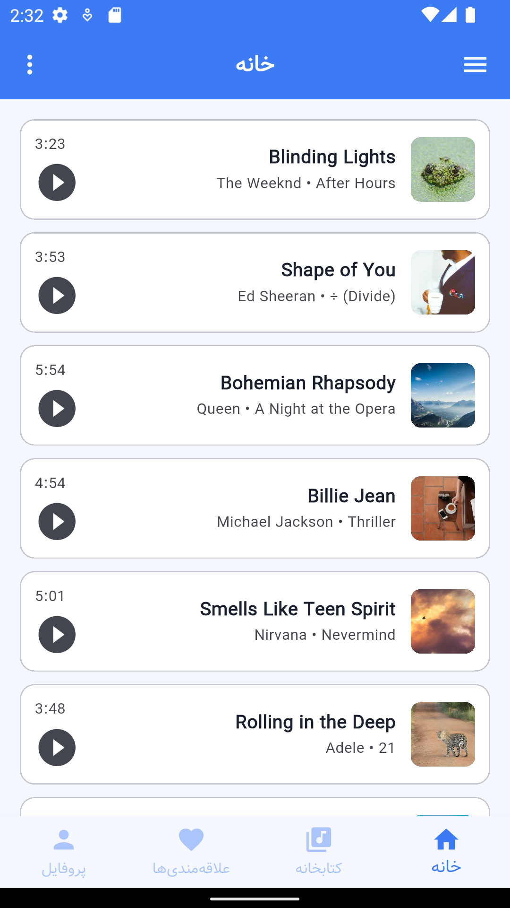
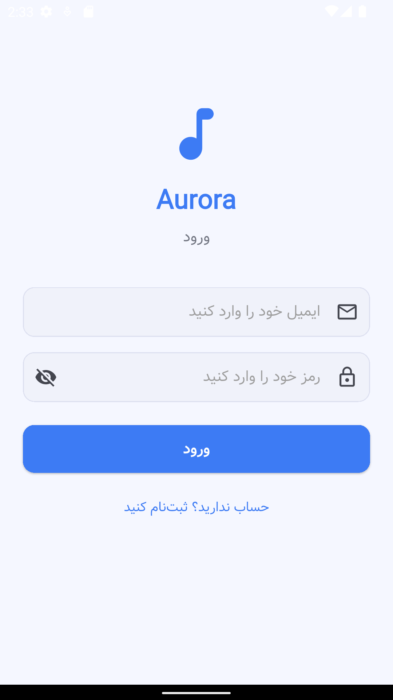
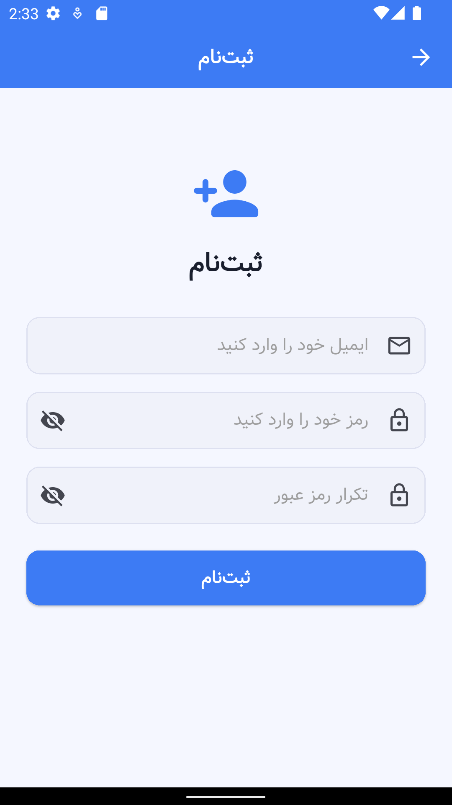
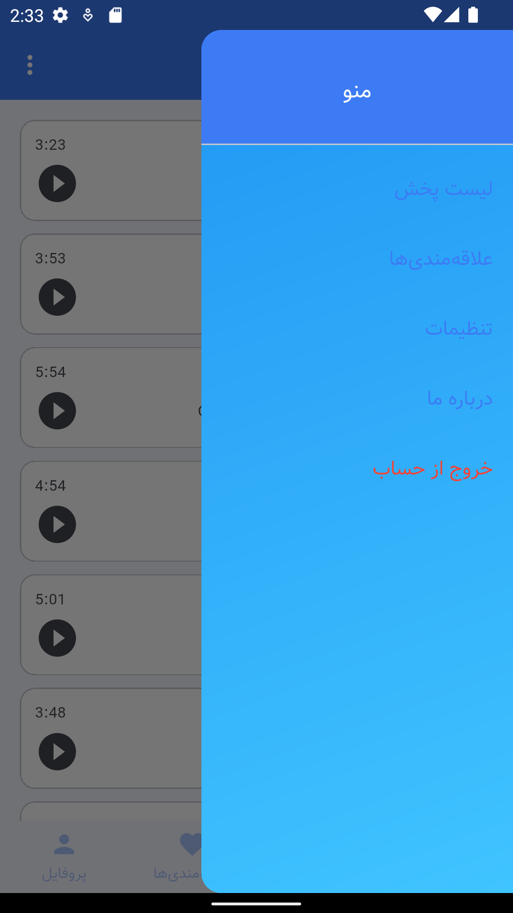
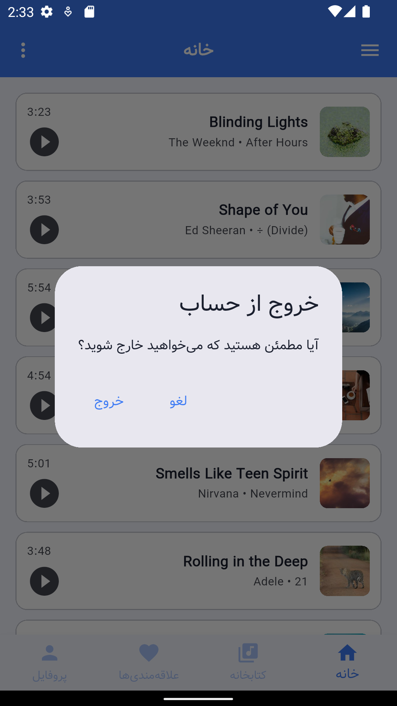
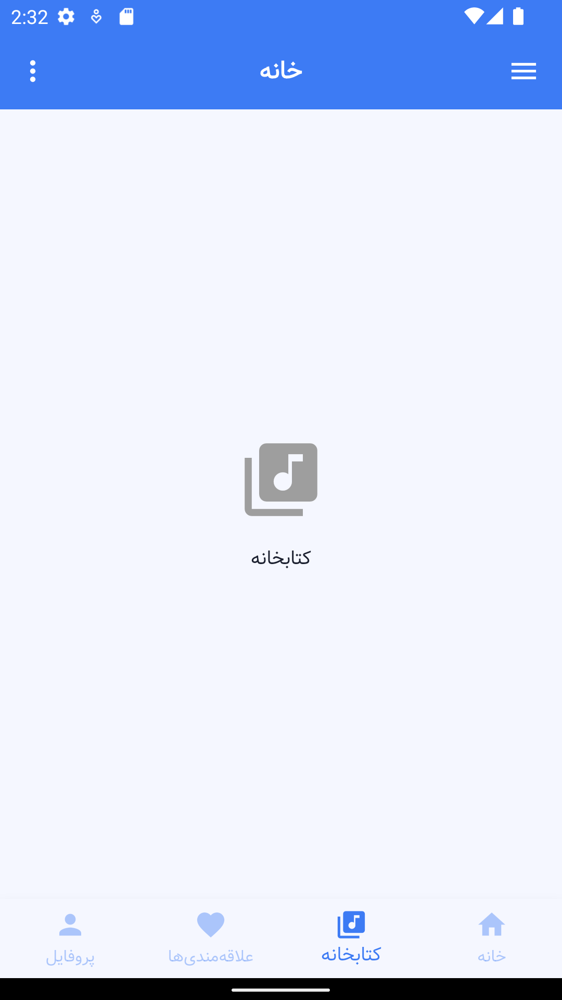

<div align="center">


# Aurora Music Player

**به شفافیت آب، به درخشندگی شفق**

[](https://flutter.dev/)
[](https://dart.dev/)
[](https://firebase.google.com/)
[](LICENSE)
[](https://flutter.dev/multi-platform)

A modern, cross-platform music player built with Flutter — focused on clean architecture, smooth UX, and reliable audio playback.

[Features](#-features) • [Screenshots](#-screenshots) • [Tech Stack](#-tech-stack) • [Getting Started](#-getting-started) • [Architecture](#-architecture) • [Roadmap](#-roadmap)

</div>

---

## ✨ Features

### Currently Available
- 🎵 **Online Music Streaming** — Fetches and streams songs from a remote JSON source
- 🔐 **Firebase Authentication** — Sign-up, login, email verification and **password reset**
- 🎨 **Light & Dark Theme** — Full Material 3 theme support with automatic system switching
- 🌍 **RTL & Persian Support** — Full Farsi localization with Vazir font
- ▶️ **Full Player Controls** — Play, pause, resume, stop, **next / previous, draggable seek bar**, auto-advance to the next track
- ❤️ **Favorites** — Heart any song; favorites are saved on the device per account
- 📋 **Song List** — Cover art, artist info, duration, active song highlighting, pull-to-refresh
- 🔁 **Smart Caching** — 10-minute in-memory cache, with an offline fallback to the last downloaded list
- 💬 **Error Handling** — User-friendly Persian error messages (raw exception text is never shown)
- 🧪 **Tests & CI** — Unit/widget tests and a GitHub Actions workflow (`flutter analyze` + `flutter test`)

### In Development
- [ ] Playlist creation and management
- [ ] Background audio with media notification
- [ ] Library organization (Library tab is still a placeholder)
- [ ] Social sign-in (Google / Apple / Spotify buttons currently show "coming soon")
- [ ] Local file playback
- [ ] Settings page (equalizer, sleep timer, quality)
- [ ] Offline mode with local database (Hive)

---

## 📸 Screenshots

| Splash | Home | Login | Register |
|--------|------|------|---------|
|  |  |  |  |

| Profile | Menu | Logout-Dialog | Library |
|---------|-----|------------|---------|
|  |  |  |  |
---

## 🛠 Tech Stack

| Category | Technology |
|---|---|
| Framework | Flutter 3.x |
| Language | Dart 3.x |
| Authentication | Firebase Auth (`firebase_core` 4.x, `firebase_auth` 6.x) |
| Remote Data | REST API over HTTP |
| Audio | `audioplayers` |
| Navigation | GoRouter |
| State | `ChangeNotifier` / `ValueNotifier` (services) |
| Local storage | `shared_preferences` |
| Equality | `equatable` |
| Localization | `flutter_localizations` (fa_IR) |
| Font | Vazir |

---

## 🚀 Getting Started

### Prerequisites

- [Flutter SDK](https://docs.flutter.dev/get-started/install) — latest stable (the project needs Dart `^3.11.3`, see `pubspec.yaml`)
- iOS builds: Xcode 16+ and iOS 15+ (required by Firebase iOS SDK 12)
- A Firebase project with **Authentication** enabled (Email/Password)
- Android Studio or VS Code with Flutter extension

### Installation

```bash
# 1. Clone the repository
git clone https://github.com/GoldenTitab/First-App.git
cd First-App

# 2. Install dependencies
flutter pub get

# 3. Configure Firebase (use YOUR OWN Firebase project)
flutterfire configure
#    -> regenerates lib/firebase_options.dart and firebase.json
#    -> download android/app/google-services.json (git-ignored) from the Firebase console

# 4. Run the app
flutter run
```

### Environment

No `.env` file is needed. Firebase configuration is handled by `firebase_options.dart`.  
Make sure **Email/Password** sign-in is enabled in your Firebase Console under Authentication → Sign-in methods.

```bash
# Run the tests
flutter test
```

### Release signing (Android)

Create `android/key.properties` (git-ignored) with `storeFile`, `storePassword`, `keyAlias` and `keyPassword`. When the file exists, release builds are signed with it; otherwise they fall back to the debug key. Before publishing, also change the `applicationId` (`com.example.first_app`) and re-register the app in Firebase.

### Security notes

- **Never commit** `google-services.json`, keystores, `.env` files or any tool config directory such as `.config/` (the Firebase CLI stores a login token there).
- Firebase API keys in `firebase_options.dart` are identifiers, not secrets — protect the project with **Security Rules**, **App Check** and API-key restrictions.

---

## 🏗 Architecture

Aurora follows a **layered architecture** separating concerns into models, services, views, widgets, and utilities.

```
lib/
├── models/
│   └── song.dart                  # Song model with Equatable + copyWith
│
├── services/
│   ├── auth_service.dart          # Firebase Auth (singleton, test constructor)
│   ├── song_service.dart          # HTTP fetch + cache + stale fallback (test constructor)
│   ├── player_service.dart        # AudioPlayer + play queue (ChangeNotifier)
│   ├── favorites_service.dart     # Per-account favorites (SharedPreferences)
│   └── onboarding_service.dart    # "Welcome seen" flag
│
├── views/
│   ├── splash_screen.dart         # Animated splash with RTL progress bar
│   ├── welcome_view.dart          # Onboarding
│   ├── login_view.dart            # Login + password reset
│   ├── register_view.dart         # Register + confirm password
│   ├── verify_email_view.dart     # Email verification polling
│   └── home_page.dart             # 4-tab layout (IndexedStack) + mini player
│
├── widgets/
│   ├── song/
│   │   ├── song_list_view.dart
│   │   ├── song_list_item.dart
│   │   ├── song_player_controls.dart   # Mini player (prev / play / next / stop)
│   │   ├── song_seek_bar.dart          # Draggable seek bar
│   │   └── song_progress_indicator.dart
│   ├── custom_bottom_navigation_bar.dart
│   ├── custom_dialog.dart
│   ├── custom_drawer.dart
│   ├── custom_elevated_button.dart
│   ├── custom_text_field.dart     # TextFormField + visibility toggle
│   └── loading_overlay.dart
│
├── utils/
│   ├── app_routes.dart            # GoRouter with auth redirect + refresh
│   ├── auth_refresh_notifier.dart # Auth stream -> router refreshListenable
│   ├── app_theme.dart             # Full light + dark Material 3 themes
│   ├── constants.dart             # Strings, durations, validators
│   ├── exception_handler.dart     # Error -> friendly Persian message
│   └── format.dart                # Duration formatting
│
├── app.dart                       # MaterialApp.router entry
├── main.dart                      # Firebase init + error handlers
└── firebase_options.dart          # Generated by FlutterFire CLI

test/                              # Unit + widget tests (run in CI)
```


### Key Design Decisions

**App-wide Services** — `AuthService`, `SongService`, `PlayerService`, `FavoritesService` are singletons, giving one source of truth for auth, cached data, playback and favorites. `AuthService`, `SongService` and `FavoritesService` expose a `@visibleForTesting` constructor (custom `FirebaseAuth` / `http.Client` + clock / fresh instance) so they can be unit-tested. A widget must never `dispose()` them — `PlayerService.dispose()` is intentionally a no-op. A dependency-injection package (Provider/Riverpod) is the natural next step.

**GoRouter with Auth Redirect** — Navigation is declarative. The `redirect` callback checks Firebase auth state and email verification, and `refreshListenable` re-runs it whenever the auth state changes, so a sign-out or expired session is reflected immediately.

**Fine-grained Rebuilds** — `PlayerService` notifies coarse changes (current song, playing, loading, error) through `ChangeNotifier`, while the playback position and duration are separate `ValueNotifier`s. Only the progress bars rebuild on every tick, not the whole song list.

**Form Validation** — All input forms use Flutter's `Form` + `GlobalKey<FormState>` with `AutovalidateMode.onUserInteraction`, so errors appear as the user types rather than only on submit.

---

## 📦 Dependencies

See [`pubspec.yaml`](pubspec.yaml) for the exact constraints. Notes:

- `firebase_core` and `firebase_auth` must always be upgraded **together**.
- Build-time tools (`flutter_launcher_icons`, `flutter_native_splash`) live under `dev_dependencies`.
- Run `flutter pub outdated` to see what can be upgraded.

---

## 🗺 Roadmap

### v1.0 — Foundation ✅
- [x] Firebase Authentication with email verification
- [x] Remote song fetching with cache
- [x] Audio playback (play / pause / stop)
- [x] GoRouter navigation with auth guard
- [x] Form validation on all input screens
- [x] Full light/dark theme
- [x] RTL + Persian localization

### v1.1 — Player Experience
- [x] Mini player persistent at bottom of all tabs
- [x] Seek bar interaction (drag to seek)
- [x] Next / Previous track controls
- [ ] Background audio + lock screen controls (migrate to `just_audio` + `audio_service`)

### v1.2 — Library & Personalization
- [x] Favorites system (local, per account)
- [ ] Sync favorites across devices (Firestore)
- [ ] Custom playlists
- [ ] Recently played history
- [ ] Search and filter

### v2.0 — Offline & Advanced
- [ ] Local file playback
- [ ] Offline cache with Hive
- [ ] Equalizer
- [ ] Sleep timer
- [ ] Cross-fade between tracks

---

## 🤝 Contributing

This project is part of an active learning journey. Contributions, issues, and suggestions are welcome.

1. Fork the repository
2. Create your feature branch: `git checkout -b feature/your-feature`
3. Commit your changes: `git commit -m 'feat: add your feature'`
4. Push to the branch: `git push origin feature/your-feature`
5. Open a Pull Request

Please follow [Conventional Commits](https://www.conventionalcommits.org/) for commit messages.

---

## 📄 License

This project is licensed under the MIT License. See the [LICENSE](LICENSE) file for details.

---

<div align="center">

Built with ❤️ by [GoldenTitab](https://github.com/GoldenTitab)

*Aurora Studio — where clarity meets resonance*

</div>